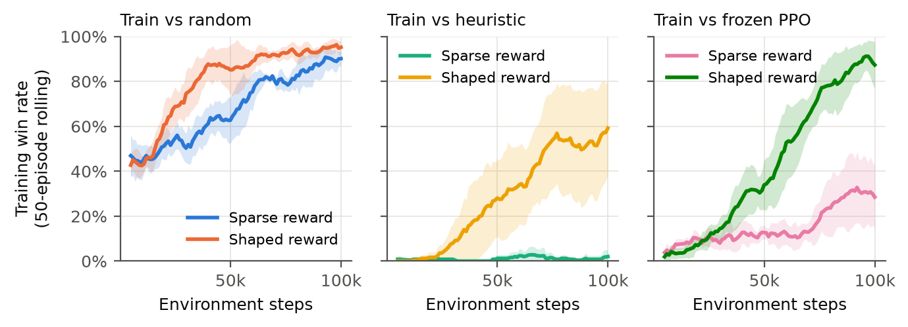
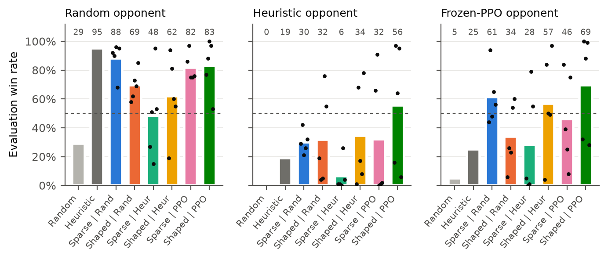
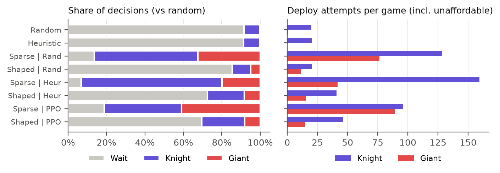

# Who You Train Against Matters: PPO in a Real-Time Card Battle Game

A lightweight Gymnasium environment for a two-lane, real-time card battle game
(inspired by games like Clash Royale), plus a study of how **reward shaping**
and **training opponent** choice affect Proximal Policy Optimization (PPO)
agents.

**Paper:** [`paper/main.tex`](paper/main.tex) (LaTeX source, tables and figures included)

## Key results

30 PPO runs (5 seeds × 2 rewards × 3 training opponents, 100k steps each). Each
agent was evaluated on 100 held-out matches against each of 3 opponents.

| Agent (reward \| training opponent) | vs Random | vs Heuristic | vs Frozen PPO |
|---|---|---|---|
| Random baseline | 29.0% | 0.0% | 5.0% |
| Heuristic baseline | 95.0% | 19.0% | 25.0% |
| Sparse \| Random | **88.2% ± 11.5** | 30.0% ± 7.8 | 61.4% ± 19.9 |
| Shaped \| Random | 69.4% ± 10.5 | 31.8% ± 32.2 | 33.8% ± 22.6 |
| Sparse \| Heuristic | 48.2% ± 30.7 | 6.4% ± 11.1 | 28.0% ± 36.6 |
| Shaped \| Heuristic | 61.8% ± 28.7 | 34.4% ± 35.9 | 56.8% ± 36.2 |
| Sparse \| Frozen PPO | 81.8% ± 9.7 | 32.0% ± 43.4 | 46.2% ± 32.5 |
| Shaped \| Frozen PPO | 83.0% ± 19.0 | **55.6% ± 42.9** | **69.4% ± 36.3** |

*Mean ± std over 5 seeds, greedy actions.*

- **Shaping speeds up learning:** it reaches an 80% training win rate 1.8× faster against the random opponent.
- **Sparse rewards fail against strong opponents:** trained against the heuristic, a sparse-reward agent wins only 6.4% of evaluation matches against it. The shaped agent wins 34.4%.
- **The training opponent drives generalization:** agents trained against the random opponent win only 30–32% against the heuristic. Shaped reward against a frozen PPO opponent generalizes best.
- **Seed variance is large:** standard deviation reaches 43 points, so single-seed results are not reliable.
- **Greedy decoding gap:** shaped agents win 94.2% against random when actions are sampled, versus 69.4% when the most likely action is always taken.
- **Different play styles:** sparse agents try to deploy on almost every step (74–85% invalid actions). Shaped agents wait for elixir and destroy the King tower far more often.

| Learning curves | Evaluation |
|---|---|
|  |  |



## Environment

- 2 lanes, 3 towers per side (2 Queen towers with 2,500 HP each, 1 King tower with 5,000 HP), unit-square board
- Elixir economy: start with 5, regenerate 0.5/s, capped at 10
- Cards: Knight (3 elixir) and Giant (5 elixir)
- Actions (5): wait, Knight-left, Knight-right, Giant-left, Giant-right
- Observation (149): towers, elixir, time, plus 10 troop slots × 7 features per side
- Win by destroying the King tower, or by having more total tower HP at 120 s
- Any policy can play as the opponent: it receives a mirrored observation

## Repository layout

```
environment/            Gymnasium env (card_battle_env.py), troops, combat, cards
experiments/
  agents.py             random and heuristic baselines
  train.py              train one PPO agent (reward x opponent x seed)
  evaluate.py           evaluate all agents vs all opponents -> episodes.csv
  analyze.py            summary tables (paper/tables) and figures (paper/figures)
  stochastic_check.py   greedy vs sampled action selection
models/                 30 trained agents (+ preliminary/ earlier runs)
results/
  evaluation/           episodes.csv (9,600 matches), summary.csv, per-seed results
  train_monitor/        per-episode training logs
  preliminary/          single-seed results from the first experiments
logs/                   TensorBoard logs
paper/                  LaTeX paper, bibliography, generated tables and figures
tests/                  unit tests for the environment
legacy/                 earlier one-off scripts, kept for history
```

## Reproduce

```bash
pip install -r requirements.txt
python -m pytest tests            # environment tests
bash run_all.sh                   # trains 30 agents, evaluates, builds tables/figures (~35 min, 16 threads)
python -m experiments.stochastic_check
```

Train or evaluate a single configuration:

```bash
python -m experiments.train --reward shaped --opponent ppo --seed 42
python -m experiments.evaluate --episodes 100
python -m experiments.analyze
```

Build the paper: upload the `paper/` folder to [Overleaf](https://www.overleaf.com), or run
`latexmk -pdf main.tex` inside `paper/`.

## Limitations

The game is simplified: two troop types, no spells or card cycle. The agent decides
every 0.5 s and the opponent every 1 s, so mirror matches are not exactly 50/50.
See the paper's Limitations section for details.
